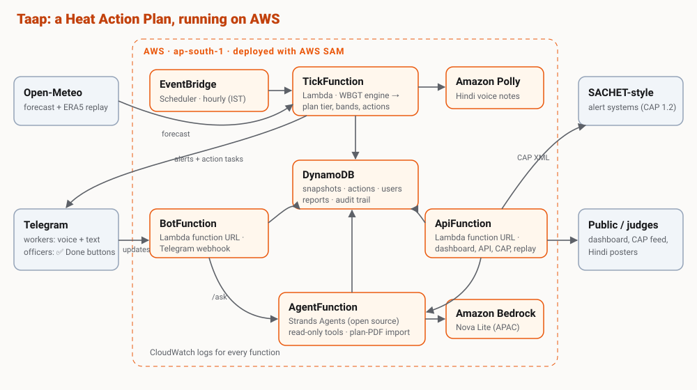

# 🔥 Taap — a city's Heat Action Plan, running and accountable

India has 250+ Heat Action Plans. Most sit as PDFs, warn city-wide on temperature alone, and nobody can tell you whether they were carried out. **Taap runs the plan:**

- **Measures heat the way bodies feel it.** Hourly outdoor **WBGT** (wet bulb globe temperature) per zone, from temperature, humidity, wind and sun (Liljegren model), not just the day's maximum temperature.
- **Tells workers what to do, in Hindi, by voice.** Work–rest schedules ("30 min work, 30 min rest, 12–4 PM") as Telegram text plus an Amazon Polly **Hindi voice note**.
- **Turns the plan into tasks with owners.** When a zone crosses the plan's thresholds, each action ("open a cooling centre in Najafgarh") goes to the named department's officer with a **✅ Done** button.
- **Makes it auditable.** A public dashboard shows *plan vs reality*: every action, who did it and when.
- **Listens to the ground.** Workers tap *No water / No shade / Work not stopped / Someone unwell*; reports go to the right officer.
- **Plugs into national systems.** A **CAP 1.2** feed (the format India's SACHET alert system ingests) and a printable **Hindi poster** for labour chowks.
- **Proves itself on history.** Replays and backtests the May–June 2024 Delhi heatwave.
- **Any city is a config file.** Delhi, Mumbai, Hyderabad, Chennai, Kolkata, Jaipur and Ahmedabad are included (all but Ahmedabad's thresholds are illustrative, from IMD/NDMA criteria).
- **A page for each audience.** Home, live dashboard, a day-by-day 2024 replay, a Hindi-first workers page (read aloud, WhatsApp share), an officers' console, a public ledger with department scores, plans as readable rules, and the method.
- **Makes the advice doable.** Nearest drinking water, shade and clinics with walking time (and a warning when the walk itself is too long in that heat); cooling centres officers open appear on the map; a safe shift planner for contractors; stricter limits for new, unacclimatised workers; QR codes on posters.
- **Saathi, a voice heat companion.** Workers talk to it in Hindi or English through the browser's speech recognition and voice. Emergencies (fainting, vomiting, confusion) go to fixed first-aid rules with tap-to-call 112, never to the model. Otherwise a Strands agent answers with tools that act — today's risk, nearest help, a shift plan, filing a report to the right officer — with a rule-based fallback when no model is available.
- **New city from its plan PDF.** Upload a Heat Action Plan; Amazon Bedrock drafts the config, a validator checks it, and a person reviews it and adds zones before it goes live.

## Architecture (all on AWS)



```
EventBridge Scheduler (hourly, IST)
        │
        ▼
 TickFunction (Lambda) ── Open-Meteo forecast for every zone
        │  WBGT engine → plan tier + worker band → plan actions → deduped alerts
        ├──► DynamoDB (single table: snapshots, actions, users, reports, alert log, cache)
        ├──► Amazon Polly (Hindi voice) ──► Telegram (workers)
        └──► Telegram (officers: action + ✅ Done)

 BotFunction  (Lambda Function URL) ◄── Telegram webhook: onboarding, Done/Resolved, reports, /ask
 ApiFunction  (Lambda Function URL) ── dashboard, JSON API, /cap.xml, /poster, replay, backtest
 AgentFunction (Lambda + Strands Agents layer) ── Amazon Bedrock; read-only tools over plan + live state
 Infrastructure as code: AWS SAM (template.yaml) · logs: CloudWatch
```

| AWS piece | Role |
|---|---|
| EventBridge Scheduler | Runs the plan every hour |
| Lambda + function URLs | Engine, bot webhook, public dashboard/API, agent |
| DynamoDB | State and audit trail (on-demand, cents at demo scale) |
| Amazon Polly | Hindi voice alerts |
| Amazon Bedrock | Officer assistant model and plan-PDF reader (default: Nova Lite APAC profile) |
| Strands Agents SDK (open source) | The officer assistant's agent loop and tools |
| AWS SAM (open source) | Build and deploy |
| CloudWatch | Logs |

## The science, briefly

- **Two scales, side by side.**
  - **Plan tier** (green/yellow/orange/red) from the day's max temperature, using the city's own thresholds. Ahmedabad: 41 / 43 / 45 °C. Delhi: derived from IMD criteria. The tier goes up one level after a **hot night**.
  - **Worker band** from hourly WBGT against ACGIH screening limits for heavy, acclimatised work:

    | Band | WBGT | Instruction |
    |---|---|---|
    | 0 | < 25 °C | Normal work |
    | 1 | 25 °C | 45 min work / 15 min rest each hour |
    | 2 | 27.5 °C | 30 / 30 |
    | 3 | 29 °C | 15 / 45 |
    | 4 | 30.5 °C | Stop heavy work |

- **Why WBGT.** Humidity and sun matter. On a humid October afternoon in Delhi, the plan tier is green while the WBGT is ~29.5 °C, which for heavy labour means 15 minutes of work per hour. We do not use the "simplified WBGT" (temperature + humidity only), which overstates heat stress in humid conditions.
- **Avoiding alert fatigue.**
  - Departments are tasked only when the plan is active (yellow tier or above).
  - Workers get a push alert from band 2; band 1 is shown on request.
  - Alerts go out once per band per day.
- **Honesty.**
  - Zones are ~10 km apart, matching the ~9 km forecast models; they are not wards.
  - Values are modelled, not station readings.
  - The replay uses ERA5 reanalysis, which runs below station peaks. IMD recorded 49.9 °C at Mungeshpur and Narela on 28 May 2024; the 52.9 °C reading was a sensor error and is not used.
- **Guidance only.** The work–rest guidance is not medical advice. Emergency number in all messages: **112**.

## Run on your own machine: no AWS account ("Build It")

Everything runs locally in one process. The officer assistant and the plan-PDF import use **Strands Agents** (AWS's open-source agent SDK) on **Groq** (free API key) or a local **Ollama** model. State is kept in a SQLite file, and the Telegram bot uses long polling, so no public URL is needed.

1. Get a free API key at [console.groq.com](https://console.groq.com/keys). Or, to stay fully offline, install [Ollama](https://ollama.com/download) and run `ollama pull llama3.2:3b`.
2. `pip install -r requirements-local.txt`
3. Copy `.env.example` to `.env` and set `TELEGRAM_TOKEN`, `OFFICER_CODE`, `ADMIN_TOKEN` and `GROQ_API_KEY`.
4. `python scripts/run_local.py`, then open http://localhost:8000.

**Public demo link without AWS (GitHub Pages).** After a live run and a replay, export a read-only snapshot of every page with its data, then publish it:
```bash
python scripts/export_static.py        # writes docs/ (pages, data, posters, CAP feeds)
git add docs && git commit -m "Demo snapshot" && git push
```
Then on GitHub: **Settings → Pages → Branch: master, folder: /docs**. The site appears at `https://<owner>.github.io/<repo>/`.

What's different from the AWS deployment:
- no Hindi voice notes (Amazon Polly needs an AWS account), so alerts are text only;
- the model runs on Groq or on your machine instead of Bedrock;
- the 2024 replay data is fetched from Open-Meteo on first use and cached locally.

Tests: `pip install pytest boto3 && python -m pytest -q tests`.

## Deploy to AWS ("Ship It")

Prerequisites: an AWS account (Paid plan recommended; credits still apply), AWS CLI, SAM CLI, Python 3.10+, and a Telegram bot token from [@BotFather](https://t.me/BotFather).

1. **Bundle the replay heatwave.** Run this from your own internet connection, because Open-Meteo rate-limits shared IPs:
   ```bash
   python scripts/fetch_replay_data.py
   ```
2. **Check Bedrock access** in `ap-south-1` for the model you will use. The default is `apac.amazon.nova-lite-v1:0`. Marketplace-listed models need a one-time use-case form and a Marketplace subscription.
3. **Deploy** (no `sam build` needed; any local Python version works):
   ```bash
   scripts/deploy.sh                      # macOS / Linux / Git Bash
   sam deploy --guided --stack-name taap --region ap-south-1 --capabilities CAPABILITY_IAM   # Windows PowerShell
   ```
   The first run is guided. Set `AdminToken`, `OfficerCode`, `TelegramToken` and a random `TelegramSecret` (16+ letters, digits, `_` or `-`). The webhook rejects every request without it.
4. **Connect Telegram:**
   ```bash
   TELEGRAM_TOKEN=... TELEGRAM_SECRET=... scripts/set_webhook.sh taap                       # bash
   $env:TELEGRAM_TOKEN="..."; $env:TELEGRAM_SECRET="..."; .\scripts\set_webhook.ps1        # PowerShell
   ```
5. **Open the `DashboardUrl` output.**
   - In Telegram, workers send `/start`.
   - Officers send `/officer <OfficerCode>`.
   - On the dashboard, choose **Replay** → 28 May 2024 → **Run replay** (⚙︎ sets the admin token).

**If a function URL returns 403:** some accounts also require `lambda:InvokeFunction` for public function URLs. See the AWS Lambda docs on function URL auth and add the permission to `ApiFunction`/`BotFunction`.

**Cost:** Scheduler, Lambda and Polly stay within free tiers at demo scale; DynamoDB on-demand costs cents. Bedrock Nova Lite costs fractions of a cent per question. Set a budget alarm.

## Adding a city

Copy `src/heatplan/cities/delhi.json` and set:
- zones (name, Hindi name, lat/lon),
- tier thresholds,
- the hot-night threshold,
- departments,
- actions (trigger, owner, text, plan reference),
- the replay window.

No code changes are needed.

## Data and credits

- **Weather:** [Open-Meteo](https://open-meteo.com) forecast and historical APIs (ERA5), CC-BY 4.0. The free tier is non-commercial.
- **Maps and help points:** © [OpenStreetMap](https://www.openstreetmap.org/copyright) contributors (ODbL), via [Leaflet](https://leafletjs.com) (BSD-2). QR codes: qrcodejs (MIT).
- **WBGT model:** Liljegren et al. (2008), *J. Occup. Environ. Hyg.* 5:645–655.
- **Work–rest limits:** ACGIH TLV screening criteria for heat stress.
- **Alert thresholds:**
  - Ahmedabad Heat Action Plan (AMC); Hess et al. (2018).
  - IMD heatwave criteria.
  - Delhi Heat Action Plan (DDMA).
  - Delhi LG order of 29 May 2024 (paid noon–3 PM break).
