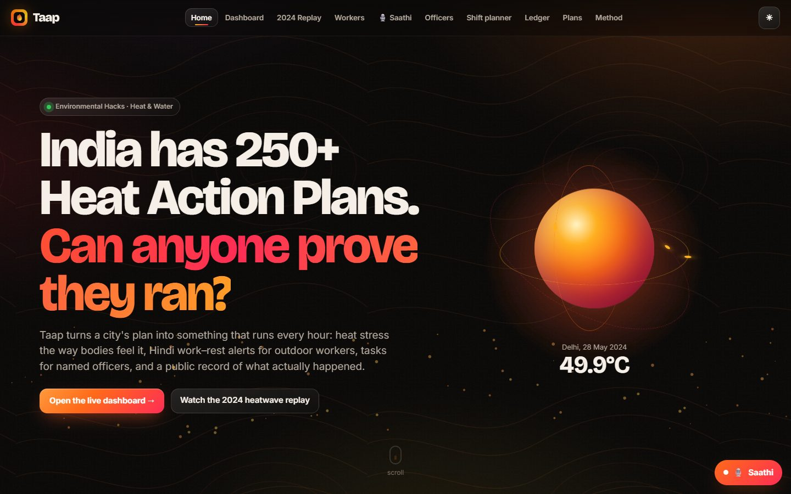
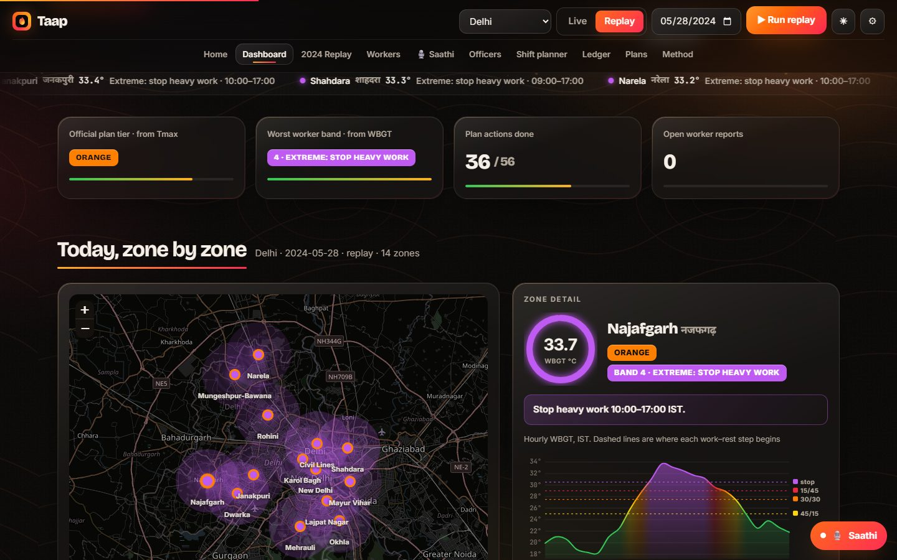
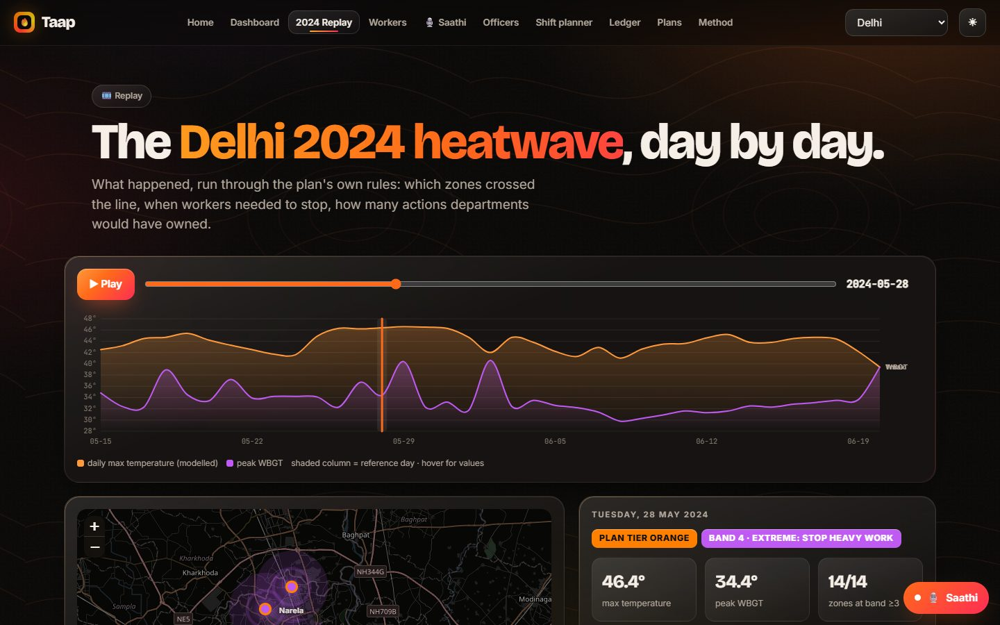
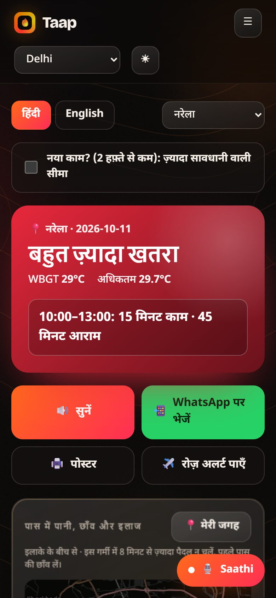
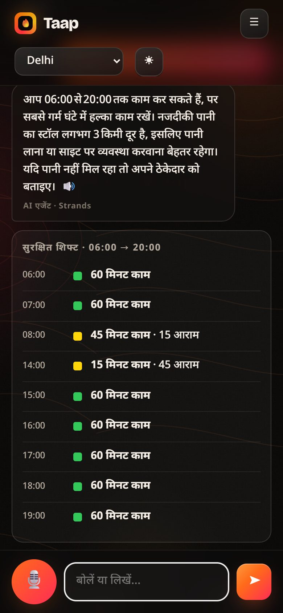
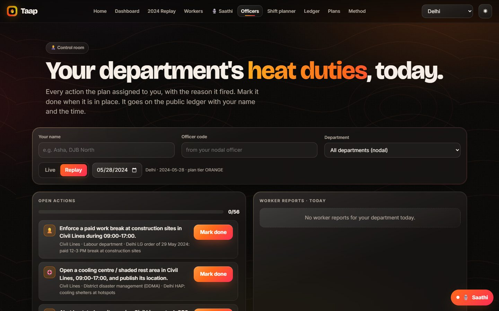
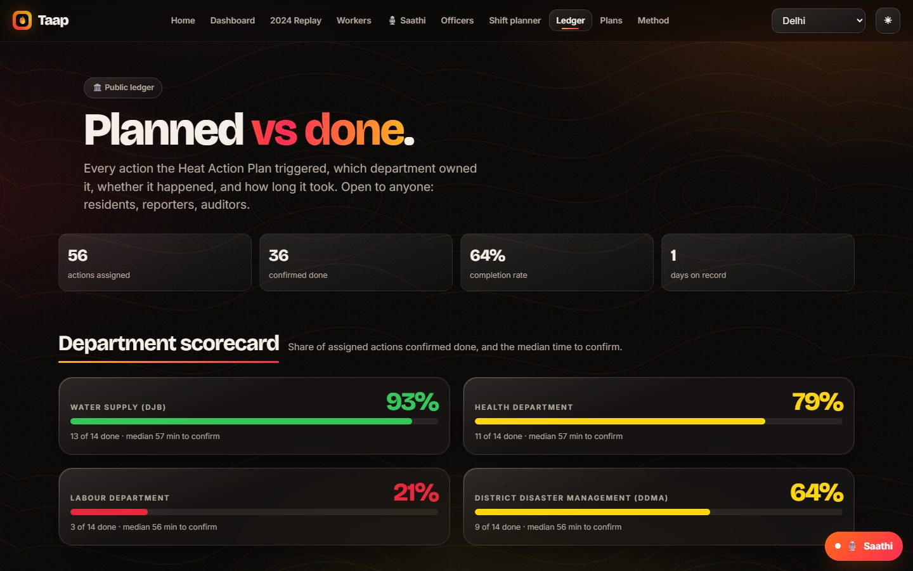
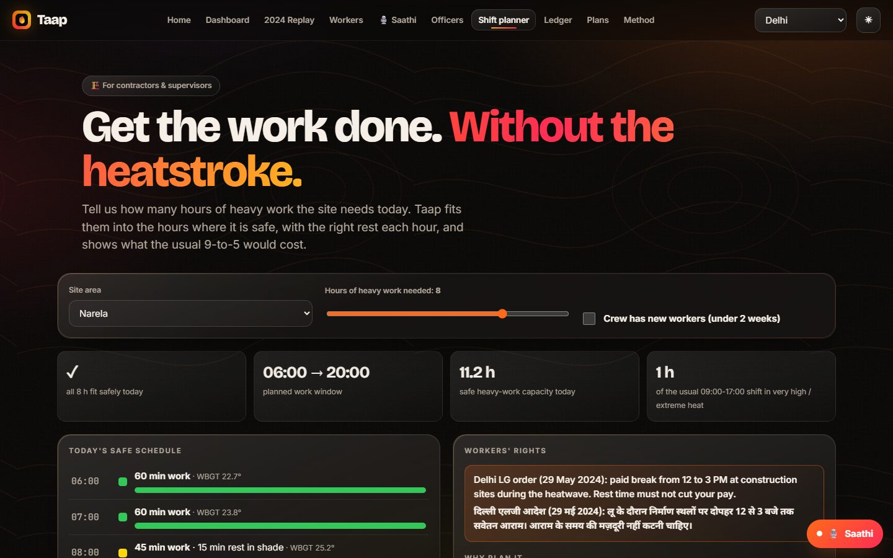

# Taap

Taap runs a city's Heat Action Plan every hour and keeps a public record of what was done.

India has more than 250 Heat Action Plans. Most of them are PDFs. They warn the whole city based on temperature alone, they rarely say who is most at risk, and nobody can check afterwards whether the plan was actually carried out. Taap takes a plan, turns its rules into code, and runs it:

- It measures heat stress the way the body feels it (WBGT, using temperature, humidity, wind and sun) for each zone, hour by hour.
- It tells outdoor workers when to work and when to rest, in Hindi or English, on Telegram and on a simple web page.
- It sends each action the plan calls for to the officer who owns it, and records when it was done and by whom.
- It lets workers report problems at their site (no water, no shade, work not stopped, someone unwell) and routes them to the right department.
- It publishes a CAP 1.2 alert feed and printable Hindi posters for people without smartphones.

Built for Environmental Hacks (Heat and Water track).



## Screenshots

**Dashboard.** Plan tier, worker risk band and zone details for any day. This is the 28 May 2024 Delhi heatwave replay.



**2024 replay.** The May to June 2024 Delhi heatwave run through the plan's own rules, day by day.



**Workers page and Saathi.** A Hindi-first page with today's schedule, read aloud and shareable on WhatsApp, plus Saathi, a voice assistant that answers questions and files reports.

<p>
  
  &nbsp;&nbsp;
  
</p>

**Officers.** Each department sees the actions assigned to it and marks them done.



**Public ledger.** Planned vs done, per department, with the time taken to confirm. (Replay demo data.)



**Shift planner.** For contractors: fits the hours of heavy work a site needs into the safe part of the day.



## How it works

Every hour Taap fetches the forecast for each zone, computes WBGT, and applies the city's plan:

1. **Plan tier** (green, yellow, orange, red) comes from the day's maximum temperature and the city's own thresholds. If the plan is already active, a hot night raises the tier by one level.
2. **Worker band** (0 to 4) comes from hourly WBGT and the ACGIH limits for heavy work.
3. When a zone crosses a threshold, the plan's actions are created and sent to the responsible officers.
4. Workers get an alert once per band per day, from band 2 upwards.

| Band | WBGT | Heavy work guidance |
|---|---|---|
| 0 | below 25 °C | Normal work |
| 1 | 25 °C | 45 min work, 15 min rest each hour |
| 2 | 27.5 °C | 30 min work, 30 min rest |
| 3 | 29 °C | 15 min work, 45 min rest |
| 4 | 30.5 °C | Stop heavy work |

New workers (less than two weeks on the job) get stricter limits.

Why WBGT and not just temperature: on a humid October afternoon in Delhi, a temperature-only plan says green, while WBGT is around 29.5 °C. For heavy labour that means only 15 minutes of work per hour.

The AI parts never decide alerts or actions. Those come from fixed plan rules. The officer assistant and Saathi only answer questions, and they use tools that read the live data, so they can't make up numbers. If someone describes an emergency (fainting, vomiting, confusion), Saathi skips the model and gives fixed first aid steps and the 112 number.

## Architecture


| Part | What it does |
|---|---|
| EventBridge Scheduler | Runs the plan every hour (IST) |
| Lambda with function URLs | Plan engine, Telegram webhook, dashboard and API, agent |
| DynamoDB | Snapshots, actions, users, reports, alert log, weather cache |
| Amazon Polly | Hindi voice notes |
| Amazon Bedrock | Model for the officer assistant, Saathi and the plan PDF reader |
| Strands Agents (AWS open source) | Agent loop and tools |
| AWS SAM (AWS open source) | Infrastructure as code (`template.yaml`) |
| CloudWatch | Logs |

The same code also runs on a single machine without an AWS account (see below).

## Cities

Delhi, Mumbai, Hyderabad, Chennai, Kolkata, Jaipur and Ahmedabad are included. Ahmedabad's thresholds come from its published plan. The others are illustrative and based on IMD and NDMA criteria.

A city is a JSON file in `src/heatplan/cities/`: zones (name, Hindi name, coordinates), tier thresholds, the hot night threshold, departments, actions (trigger, owner, text, plan reference) and a replay window. No code changes are needed to add one.

You can also start from a plan PDF on the Plans page. The model drafts the config, a validator checks it, and a person reviews it and adds zones before it goes live.

## Run it locally (no AWS account)

Everything runs in one process. State is kept in SQLite and the Telegram bot uses long polling, so no public URL is needed. The assistant uses Strands Agents with Groq (free API key) or a local Ollama model.

1. Get a free key at [console.groq.com](https://console.groq.com/keys), or install [Ollama](https://ollama.com/download) and run `ollama pull llama3.2:3b`.
2. `pip install -r requirements-local.txt`
3. Copy `.env.example` to `.env` and fill in:
   - `TELEGRAM_TOKEN`: from [@BotFather](https://t.me/BotFather)
   - `BOT_USERNAME`: your bot's username, without the @
   - `OFFICER_CODE`: any code you choose; officers send `/officer <code>` to register
   - `ADMIN_TOKEN`: needed to run replays from the dashboard
   - `GROQ_API_KEY`
4. `python scripts/run_local.py` and open http://localhost:8000

In Telegram, workers send `/start` and pick a city and area. Officers can use the bot or the Officers page on the website. To see the whole flow, open the Dashboard, switch to Replay, pick 28 May 2024 and click Run replay.

Differences from the AWS version: no voice notes (Polly needs AWS), and the 2024 replay data is downloaded from Open-Meteo the first time and cached.

### Hosting: Render (backend) and Vercel (frontend)

The Python app runs on Render. Vercel serves the pages in `src/web` and forwards `/api`, `/cap.xml` and `/poster` to Render (see `src/web/vercel.json`), so the browser only talks to the Vercel URL.

1. **Render:** New, Blueprint, pick this repo. `render.yaml` creates the `taap-heat-action-api` service. Fill in `TELEGRAM_TOKEN`, `BOT_USERNAME`, `OFFICER_CODE`, `ADMIN_TOKEN` and `GROQ_API_KEY`. Once deployed, `https://taap-heat-action-api.onrender.com/api/meta` should answer.
2. **Vercel:** Add New, Project, import this repo, set Root Directory to `src/web`, Framework Preset "Other", no build command. Deploy.
3. If Render gives the service a different URL, update the three rewrites in `src/web/vercel.json`.

Notes:
- Stop any local copy of the app before Render starts. Only one process can poll a Telegram bot at a time.
- Render's free plan sleeps after 15 minutes without traffic, which pauses the hourly run and the bot. A free uptime monitor (for example UptimeRobot) calling `/api/meta` every 10 minutes keeps it awake.
- The free plan has no persistent disk, so state (subscriptions, actions done, reports) resets when the service restarts. The 2024 replay data is bundled in `src/heatplan/replay_data`, so replays work right away.

### Static demo on GitHub Pages

```bash
python scripts/export_static.py
git add docs && git commit -m "Demo snapshot" && git push
```

Then enable Pages under Settings, Pages, branch `master`, folder `/docs`.

### Tests

```bash
pip install pytest boto3
python -m pytest -q
```

## Deploy to AWS

You need an AWS account, the AWS CLI, the SAM CLI, Python 3.10 or newer and a Telegram bot token.

1. Bundle the replay data (Open-Meteo rate-limits shared IPs, so run this from your own connection):
   ```bash
   python scripts/fetch_replay_data.py
   ```
2. Check that Bedrock model access is enabled in `ap-south-1`. The default model is `apac.amazon.nova-lite-v1:0`.
3. Deploy:
   ```bash
   scripts/deploy.sh                    # macOS, Linux, Git Bash
   sam deploy --guided --stack-name taap --region ap-south-1 --capabilities CAPABILITY_IAM   # PowerShell
   ```
   Set `AdminToken`, `OfficerCode`, `TelegramToken` and a random `TelegramSecret` (16 or more letters, digits, `_` or `-`).
4. Connect the bot:
   ```bash
   TELEGRAM_TOKEN=... TELEGRAM_SECRET=... scripts/set_webhook.sh taap
   ```
   On Windows use `scripts/set_webhook.ps1`.
5. Open the `DashboardUrl` output.

If a function URL returns 403, your account may also need `lambda:InvokeFunction` for public function URLs on `ApiFunction` and `BotFunction`.

At demo scale, Scheduler, Lambda and Polly stay in the free tier, DynamoDB costs a few cents, and Nova Lite costs a fraction of a cent per question.

## Limitations

- Zones are about 10 km apart to match the forecast models (about 9 km). They are not wards.
- All values are modelled, not station readings. The replay uses ERA5 reanalysis, which reads lower than station peaks. IMD recorded 49.9 °C at Mungeshpur and Narela on 28 May 2024. The 52.9 °C reading that made the news was a sensor error and is not used.
- The work and rest guidance is not medical advice. Every message includes the emergency number, 112.

## Data and credits

- Weather: [Open-Meteo](https://open-meteo.com) forecast and historical (ERA5) APIs, CC BY 4.0
- Maps and help points: [OpenStreetMap](https://www.openstreetmap.org/copyright) contributors (ODbL), shown with [Leaflet](https://leafletjs.com)
- QR codes: qrcodejs (MIT)
- WBGT model: Liljegren et al. (2008), Journal of Occupational and Environmental Hygiene 5:645-655
- Work and rest limits: ACGIH TLV screening criteria for heat stress
- Thresholds: Ahmedabad Heat Action Plan (AMC), Hess et al. (2018), IMD heatwave criteria, Delhi Heat Action Plan (DDMA), Delhi LG order of 29 May 2024 (paid break from 12 to 3 PM)
